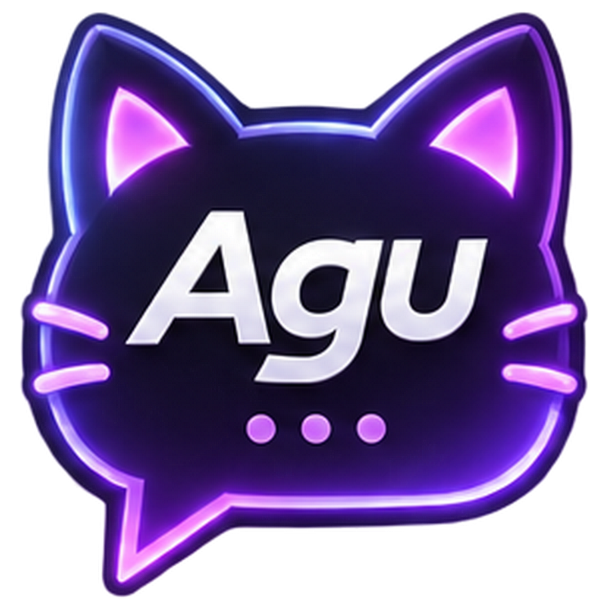
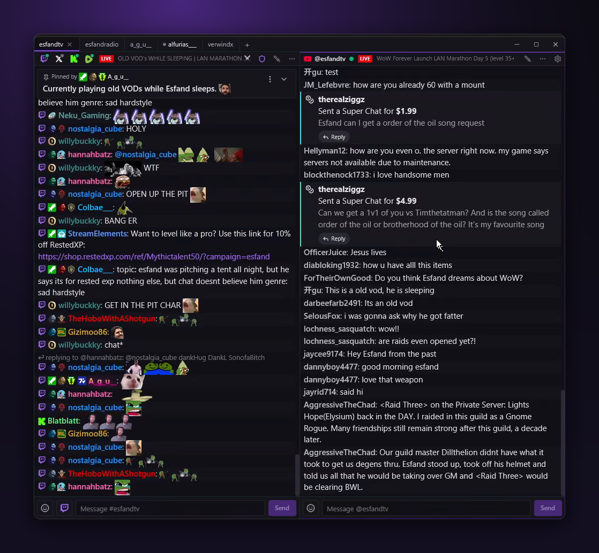
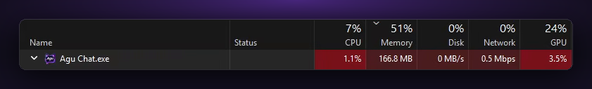
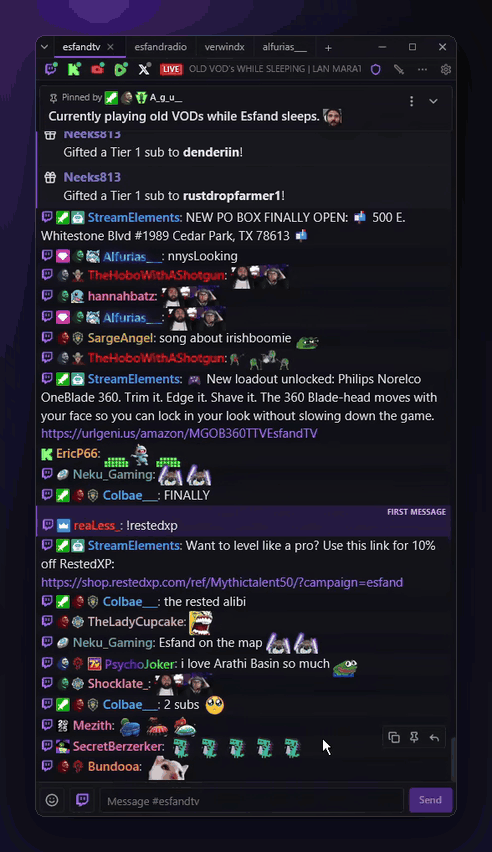
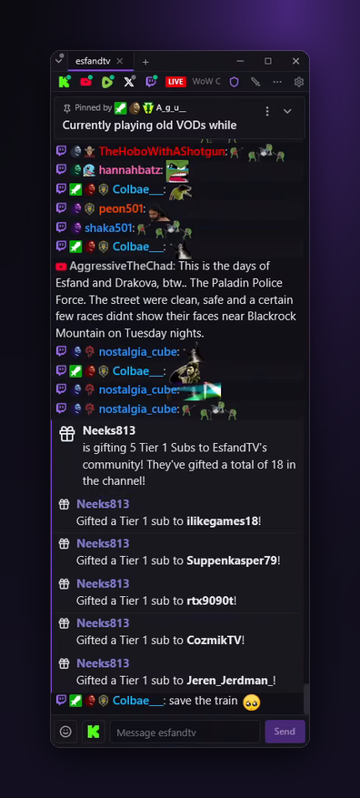
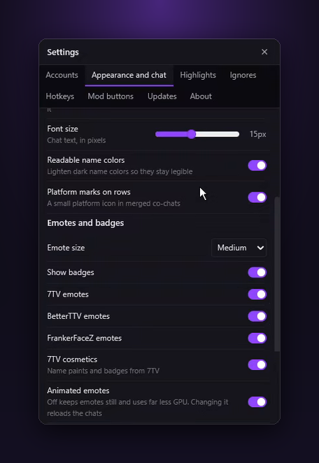

<p align="center">
  
</p>

<h1 align="center">Agu Chat</h1>

<p align="center">
  <b>Every chat, one window.</b><br />
  A fast, native desktop chat client for streamers and moderators, on Windows and Mac.<br />
  Twitch, Kick, YouTube, Rumble and X, side by side or merged into one.
</p>

<p align="center">
  <a href="https://github.com/TrinityTF/agu-chat/releases"></a>
  <a href="https://github.com/TrinityTF/agu-chat/releases"></a>
</p>

<p align="center">
  <a href="https://github.com/TrinityTF/agu-chat/releases"></a>
  
  
  <a href="https://github.com/TrinityTF/agu-chat/issues"></a>
</p>

<p align="center">
  
  
  
  
  
</p>

<p align="center">
  
</p>

> [!NOTE]
> Agu Chat is in beta. Expect rough edges, and please report bugs in [Issues](https://github.com/TrinityTF/agu-chat/issues).

## Why Agu Chat

<table>
  <tr>
    <td width="33%" valign="top">
      <h3>⚡ Native and light</h3>
      Written in Rust and drawn on the GPU. A 7 MB installer, and around 1% CPU in a busy chat, so it stays quiet next to a game or a stream.
    </td>
    <td width="33%" valign="top">
      <h3>🔀 Every platform at once</h3>
      Put Twitch, Kick, YouTube, Rumble and X in one split, each message marked with its platform, and send to one chat or all of them.
    </td>
    <td width="33%" valign="top">
      <h3>🛡️ Made for mods</h3>
      Mod buttons on every message, user cards with history, AutoMod, channel modes and blocked terms, all a click away.
    </td>
  </tr>
</table>

<p align="center">
  <br />
  <sub>Agu Chat in Task Manager with several busy chats open.</sub>
</p>

## See it in action

<table>
  <tr>
    <td width="50%" align="center" valign="top">
      <br />
      <sub><b>Live chat</b> with Twitch, 7TV, BTTV and FFZ emotes, badges and name paints.</sub>
    </td>
    <td width="50%" align="center" valign="top">
      <br />
      <sub><b>Sub and gift notices</b> that show who gave and who got each sub.</sub>
    </td>
  </tr>
</table>

## Features

**Layout**
- **Tabs and splits:** as many tabs as you like, each with chats side by side or stacked. Drag to resize or rearrange.
- **A window that fits:** the window grows to fit a new split and shrinks back when you take one away. A split only goes beside another when your screen has room for both.
- **Merged chats:** put channels from different platforms into one split, each message marked with its platform.
- **Tab markers:** the dot on a tab is green while one of its channels is live, grey when new messages arrive while you're elsewhere, and red when one of them mentions you or matches a highlight.

**Chat**
- **Emotes and badges:** Twitch, 7TV, BTTV and FFZ emotes, 7TV name paints, and each platform's own emotes and badges. Animated emotes can be turned off in Settings, which takes most of the GPU load away.
- **Subs, gifts and Super Chats:** subscriptions, resubs and gifted subs show as their own notices, with who gave and who got them. YouTube Super Chats and Super Stickers show the same way, in the Super Chat's colour, with a Reply button.
- **Removed messages:** a timed-out, banned or deleted message stays readable but greyed out, with the reason after it (for example "Timed out (10m)").
- **Recent history** loads when you open a Twitch channel, so a new split isn't empty.
- **Search:** Ctrl+F in a split filters it to matching messages; `from:name` shows one person's messages.

**Sending**
- **Choose where to send:** in a merged split, the button next to the message box picks one chat or all of them. A chat you can't write in says why: "not logged in", "offline" (X, YouTube and Rumble chats only take messages while the stream is live) or "read-only".
- **Typing:** Tab completes emotes and names; `:` searches emotes, `@` mentions people, `/` lists commands. There's an emote picker, and Up brings back what you sent.

**Moderation**
- **Mod mode** adds mod buttons to every message: ban, timeout, warn and delete by default, or your own set (any timeout length, or a command such as `/announce …`) in **Settings → Mod buttons**.
- **Channel modes:** the shield in a split's header sets Shield Mode, subscribers-only, emote-only, unique chat, followers-only and slow mode, and the channel's blocked terms.
- **User cards:** click a name for the user's messages, warnings, timeouts, bans and mod comments, with mod actions.
- **AutoMod:** approve or deny held messages right in chat.
- **Slash commands** such as `/ban`, `/timeout`, `/slow`, `/announce`, `/raid` and `/pin`.

**Make it yours**
- **Highlights:** colour messages that contain a word or phrase, match a regular expression, come from a certain user, or come from someone with a certain badge (broadcaster, moderator, lead moderator, verified, VIP or founder), on every platform. Each rule can play a sound (a built-in ping or your own file) and flash the taskbar (on a Mac, bounce the Dock icon). Messages that mention your Twitch name are highlighted too.
- **Ignores:** hide messages from users you don't want to see, and hide or rewrite messages containing words or patterns you choose.
- **Keyboard shortcuts:** change or add shortcuts in **Settings → Hotkeys**.
- **Automatic updates** on the Beta or Stable channel.

## Platforms

| | Read chat | Send messages | Moderate | Log in |
| --- | :---: | :---: | --- | --- |
|  **Twitch** | ✅ | ✅ | ✅ where you're the broadcaster or a moderator | **Settings → Accounts**, then approve on twitch.tv |
|  **Kick** | ✅ | ✅ | ✅ where you're the broadcaster or a moderator | **Settings → Accounts → Kick** |
|  **YouTube** | ✅ | ✅ while live | ✅ where you're the channel owner or a moderator | **Settings → Accounts → YouTube**. Shows every message (YouTube's "Live chat" view, not "Top chat") |
|  **Rumble** | ✅ | ✅ while live | ✅ where Rumble allows your account | **Settings → Accounts → Rumble**. Your password is only used to sign in and is never saved |
|  **X** | ✅ | ✅ while live | Not yet | **Settings → Accounts → X**, to see names and write in chat. Paste the broadcast link to be sure the chat is found |

## Getting started

1. Download Agu Chat from [Releases](https://github.com/TrinityTF/agu-chat/releases):
   - **Windows 10 or 11 (64-bit):** `Agu-Chat-Setup-<version>-x64.exe`, then run it.
   - **macOS 11 or later (Apple Silicon, M1 and newer):** `Agu-Chat-<version>-mac.zip`. Open it and drag **Agu Chat** into Applications. The first time, right-click Agu Chat and choose **Open**, then **Open** again (the app isn't signed by Apple yet). When you first log in somewhere, allow Agu Chat to use the Keychain, where your logins are kept.
2. Click **Add a channel** in a new tab. Add channels from several platforms to one split to merge them.
3. Log in to the platforms you want to write in under **Settings → Accounts**.

Agu Chat keeps itself up to date after that.

<details>
<summary><b>Shortcuts and how-tos</b></summary>

On a Mac, use Cmd where this says Ctrl (Ctrl+Tab stays Ctrl+Tab). Settings also opens with Cmd+, or **Agu Chat → Settings…** in the menu bar.

| To do this | Do this |
| --- | --- |
| New tab | `+` or Ctrl+T |
| Rename a tab | Double-click it |
| Close a tab | Select it, then its × or a middle click (asks first if it has channels) |
| Switch tabs | Ctrl+Tab, Ctrl+1…9 |
| Add a split | `⋯` on a split's header → Add split right / below |
| Resize splits | Drag the line between them |
| Move a split | Drag its header onto another split's edge |
| Merge splits | Drag a split's header (or a platform icon) onto the middle of another split |
| Tab into splits | Drag another tab onto an edge of a split: its splits move in beside it and the tab closes |
| Split into a tab | Drag a split's header (or a platform icon) onto the tab bar |
| Close a split | Ctrl+W |
| Merge platforms | In the channel dialog, add several channels to one split |
| Split a channel back out | Click its platform icon on the split's header → Split out to the right / below, or drag the icon onto any split's edge |
| Mod mode | The sword button on a split's header |
| Mention someone | Ctrl+click their name: the message box starts with `@name` |
| User card | Click a name: it opens in its own small window you can move anywhere, and several can be open |
| Always on top | Settings → Appearance and chat |
| All tabs | The arrow at the left edge of the tab bar lists every tab; the bar shows the ones that fit, always with the current tab |
| Search a split | Ctrl+F, then type words and/or `from:name`; Esc closes it |
| Ignore someone | "Ignore user" on their user card, or Settings → Ignores |
| New line in a message | Shift+Enter |
| Highlight rules and alert sounds | Settings → Highlights |
| Settings | Ctrl+P or the gear in the top-right split's header |
| Change shortcuts | Settings → Hotkeys: click `+` next to an action and press the keys |
| Change mod buttons | Settings → Mod buttons |

</details>

<details>
<summary><b>Settings</b></summary>
<br />
<p align="center">
  
</p>

Appearance, emote providers, highlights, ignores, hotkeys, mod buttons and updates all live in one Settings window (Ctrl+P).

</details>

## Updates

In **Settings → Updates** choose a channel:

- **Beta:** every new release, so you get new features first.
- **Stable:** only full releases (version 1.0.0 and up). Until 1.0.0 is out, every release is a beta, so Stable also receives them.

New versions download in the background and install when you close Agu Chat, or right away with **Restart to update**. On a Mac this needs Agu Chat to be in Applications (or another folder you can write to); otherwise **Restart to update** opens the download page. Switching from Beta to Stable keeps your current version until a newer stable one is out.

## Privacy

Your logins are stored only on your computer, encrypted with Windows' own protection (on a Mac, with a key kept in your Keychain), and are never sent anywhere except to the platform they belong to. Twitch login happens on twitch.tv, so your password never goes through Agu Chat, and you can revoke access at any time (Twitch → Settings → Connections).

The one exception is Kick: its login and token refresh go through Agu Chat's sign-in service at api.agu.lol, which passes the tokens to your computer and keeps nothing. X and YouTube logins happen in a sign-in window inside Agu Chat (it shows x.com's or Google's own page, so your password goes to them only); only the resulting session is kept, encrypted on your computer like the others.

Settings and logs are in `%APPDATA%\Agu Chat\` on Windows and `~/Library/Application Support/Agu Chat/` on a Mac.

## Building from source

Needs a recent Rust toolchain (the version is pinned in `native/rust-toolchain.toml`).

```bash
cd native
cargo build --release -p agu-chat-gpui
```

The program is `native/target/release/agu-chat-gpui.exe` (`agu-chat-gpui` on macOS; `native/installer/mac/bundle.sh` wraps it into `Agu Chat.app`). `cargo test -p agu-chat-core -p agu-chat-gpui` runs the tests.
